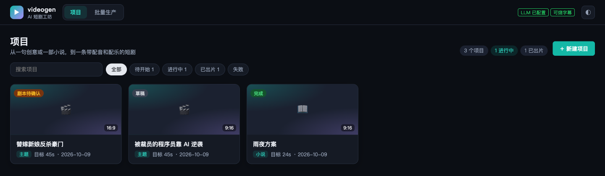
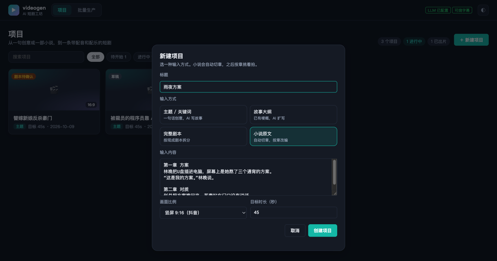
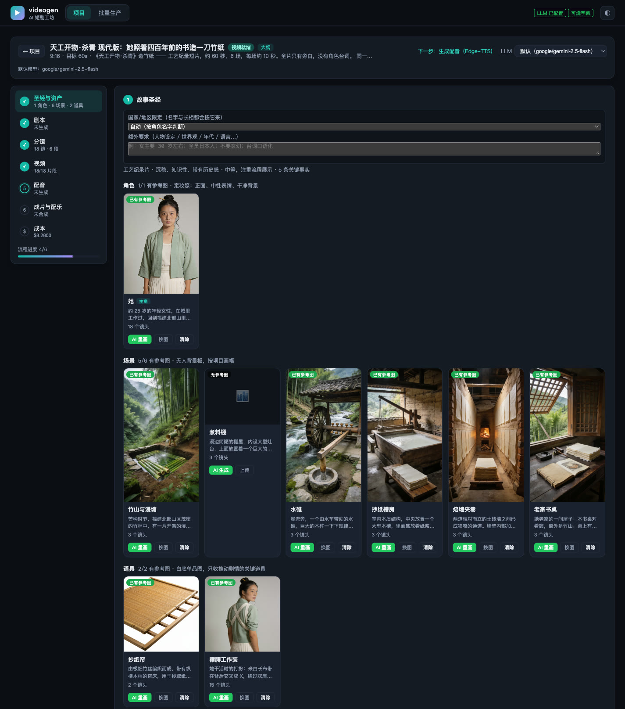
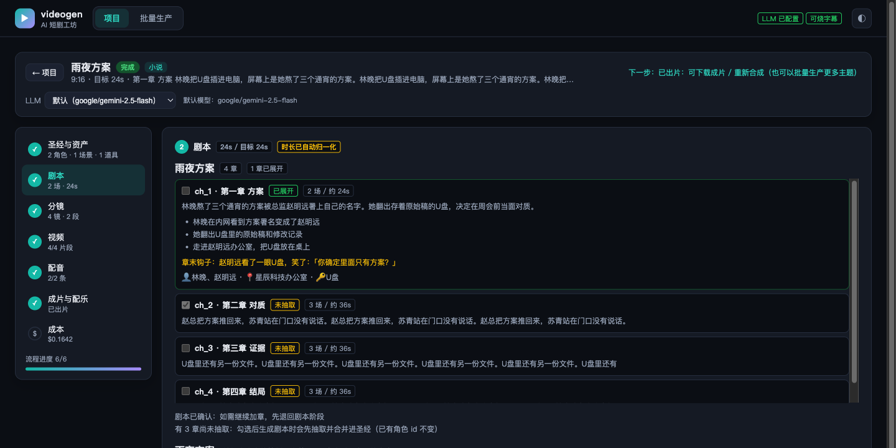
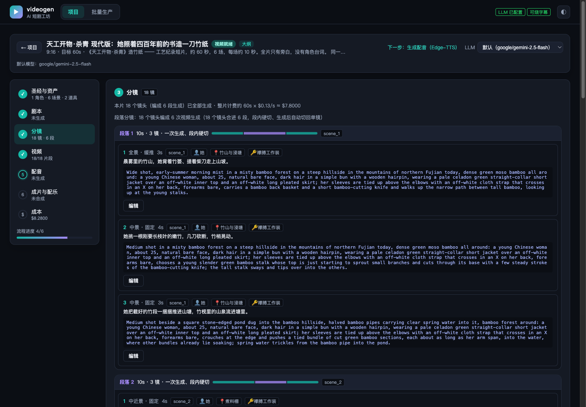
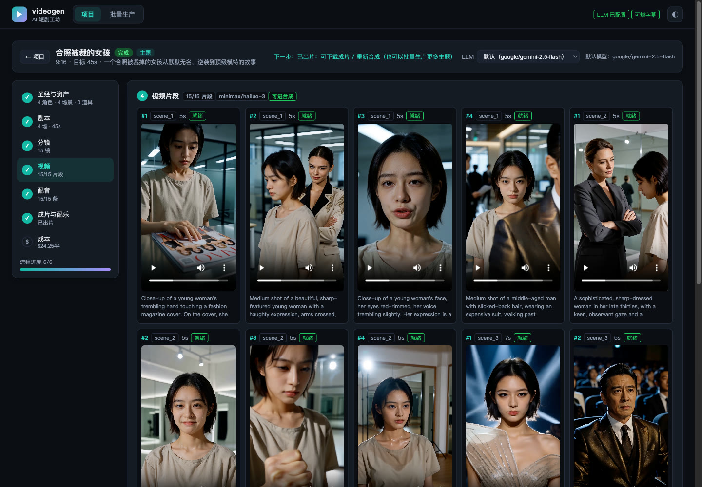
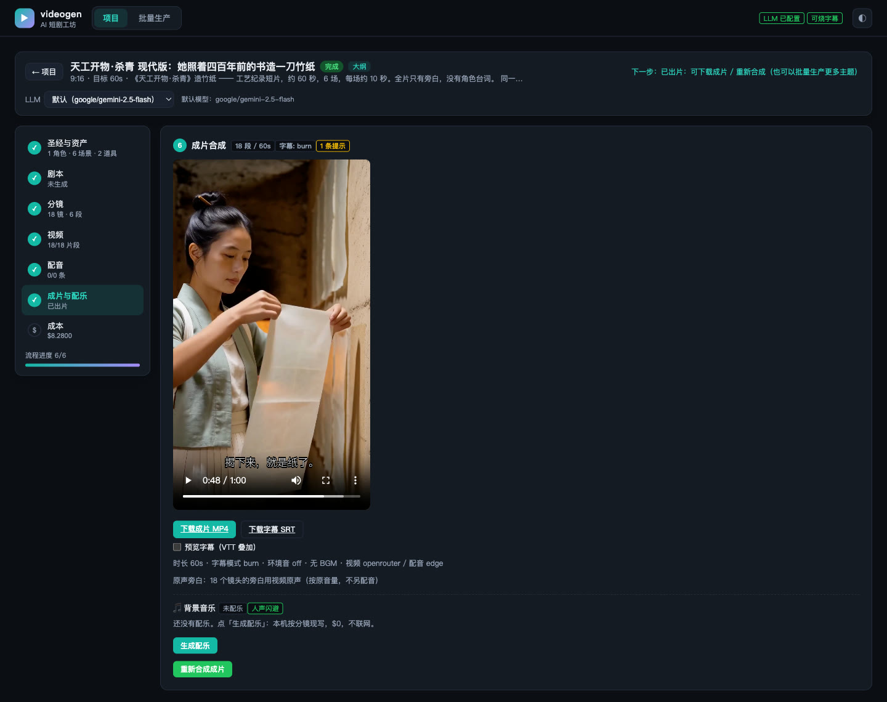

# videogen

AI 短剧自动化流水线：从一句创意、一份大纲、一部完整剧本或一部小说出发，自动完成
**故事圣经 → 剧本 → 分镜 → 视频片段 → 配音 → 配乐 → 成片（含字幕）**，每个关键节点都可以人工审改。

```
创意 / 大纲 / 剧本 / 小说
        │  LLM（OpenRouter）
        ▼
故事圣经（角色 · 场景 · 关键道具 · 关键事实 · 风格）──▶ 剧集资产（定妆照 / 场景图 / 道具图）
        ▼
剧本（逐场：对白 · 情绪 · 世界状态）        [人工确认]
        ▼
分镜（镜头 · 运镜 · 英文视频 prompt · 段落）  [人工确认]
        ▼
视频片段（按段生成）→ 配音（TTS）→ 配乐（本机作曲 / 曲库）
        ▼
FFmpeg 合成：音画对齐 · 人声闪避 · 响度归一 · 字幕 · 变速 → 成片 MP4
```

> 项目状态、已知限制、风险和各功能的实测记录见 [AGENTS.md](AGENTS.md)；
> 设计文档见 [DESIGN.md](docs/DESIGN.md)；逐版修复记录见 [FIXES.md](docs/FIXES.md)。

## 功能

**故事与剧本**
- 四种输入：主题 / 故事大纲 / 完整剧本 / **小说原文**（自动切章，按章挑着改编）
- 故事圣经：角色、场景、关键道具、关键事实、风格；可指定国家/地区（名字与长相跟着走）和额外要求
- 长篇剧集大纲：先写 20+ 章的全篇骨架，再勾选要拍的章展开成剧本
- 逐场写剧本，带世界状态与一致性校验；LLM「剧本医生」做结构评审，硬伤会拦住确认

**分镜与视频**
- 分镜自带英文视频 prompt、运镜、情绪、地点、画面里的角色与道具
- **段落分镜**：同场相邻镜头编成 8-15 秒的一段，一次生成、段内硬切，再自动切回单镜片段
- 视频模型可插拔（默认 mock 免费出占位片，接 OpenRouter 上的真实视频模型按秒计费）
- 角色 / 场景 / 道具参考图随镜头送进视频模型，保持跨镜头一致

**声音与成片**
- 配音：Edge-TTS（免费）或云端 TTS（支持自然语言念法），按角色自动选角
- 可选：让多模态 LLM 看着画面写旁白、改台词、给念法
- 配乐：按分镜本机现写（段落对齐镜头、动作给重音）或曲库选曲；说话时自动压低音乐
- 逐条配音响度归一 + 成片响度归一；字幕软字幕 / 烧录 / 外挂 SRT·VTT；整片变速
- 可选：逐帧口型（Wav2Lip ONNX，本地 CPU）

**成本控制**
- 动手前先看账（preflight）：按模型真实计费档位算秒数与金额
- 预算上限：超预算在提交前直接拒绝；按阶段记账，优先用 provider 实报扣费

**工作台**
- Web 界面：项目卡片首页、项目内阶段导航、剧集资产卡片、分镜按段落分组、明暗主题
- REST API、后台任务（进度 / 取消 / 重启恢复）、批量生产

## 安装与启动

需要 Python 3.11+；ffmpeg 可选（没有时 `media` 依赖会带一个便携版）。

```bash
python -m venv .venv && .venv/bin/pip install -e ".[dev,media]"
cp .env.example .env                  # 填入 OPENROUTER_API_KEY
python -m videogen.tools.demo_bgm     # 可选：生成 4 首演示 BGM 到 ./assets/bgm
./run.sh                              # 打开 http://127.0.0.1:8001
```

- 只填 `OPENROUTER_API_KEY` 就能跑通文本链路；视频默认 `VIDEO_PROVIDER=mock`（免费占位片），
  配音默认 `TTS_PROVIDER=edge`（免费、不用 key，需要联网）
- ffmpeg 查找顺序：`FFMPEG_PATH` → `PATH` → `imageio-ffmpeg`。都没有时视频/配音只产出明确标记的
  占位文件，合成会拒绝
- 监听地址：`HOST=0.0.0.0 PORT=8001 RELOAD=0 ./run.sh`。**暴露到局域网前先设置 `API_TOKEN`**

跑测试与静态检查：

```bash
.venv/bin/python -m pytest -q
.venv/bin/ruff check src tests tools
```

## 使用 Web 工作台

启动后打开 `http://127.0.0.1:8001`。下面的截图大多来自真实项目「天工开物·杀青 现代版」：
一位年轻女孩照着《天工开物·杀青》亲手造竹纸，60 秒、18 个镜头编成 6 段，视频用 MiniMax H3（OpenRouter）生成，
旁白由 H3 原生直出（`VIDEO_PROMPT_NARRATION`）。定妆照、场景图、道具图由 seedream 按文字设定生成。
视频计费 $7.80，图片 $0.48。设计与试拍过程见 [docs/source_material/tiangong_shaqing.md](docs/source_material/tiangong_shaqing.md)。
这个项目的分镜是手写的，没走剧本阶段，所以「剧本」那张截图来自另一个完整跑通的项目「合照被裁的女孩」
（45 秒、15 个镜头，云端 TTS 配音，本机按分镜作曲）。人物均为虚构。

### 1. 新建项目

首页列出所有项目，可按状态筛选、搜索。点右上角「新建项目」：



选一种输入方式，填标题、内容、画面比例、目标时长和成片语言（中文 / English）。选「小说原文」时直接粘贴整本或几章原文，系统会自动切章：



项目的产物目录（也是项目 id）按「建项日期-标题」命名，例如 `projects/20261010-孔乙己-第一场试拍/`；
标题不填时从内容里取（小说取书名那一行，其它取第一句），同名项目自动加 `-2`、`-3`。
老版本的随机目录名（如 `2fabf66fbb35`）可以用 `tools/projects/rename_legacy.py` 一次改完（默认只预览）。

### 2. 故事圣经与剧集资产

进入项目后，左侧是阶段导航：每个阶段显示完成情况和摘要，状态推进后会自动跳到下一步。
第一步「生成圣经」（小说项目可设置先抽取前几章）。生成后，角色、场景、关键道具以卡片列出，
每张卡片可以 **AI 生成** 参考图（角色是定妆照、场景是无人背景板、道具是白底单品图）或 **上传** 自己的图。
配了图的资产会在生成视频时一起送给视频模型，保持跨镜头一致。
卡片上的「按意见重写」只重写这一条设定（id、参考图、音色不变；外貌改了会提示重画参考图，
`POST /api/projects/{id}/bible/{characters|settings|props}/{item_id}/regenerate`），
「按描述画」用你自己的话描述画面出图：任何语言都行，非英文会先由 LLM 翻成英文
（图片模型会把 prompt 里的中文画成文字），实际发出去的英文 prompt 会显示出来：



### 3. 剧本

普通项目直接点「生成剧本」。长篇项目和小说项目会先显示章节列表：勾选要拍的章，按钮上会显示预计时长和视频费，
点「生成选中章节的剧本」即可（小说里没抽取过的章会先抽取、增量并进圣经）。生成后检查剧本和校验报告，
没问题就「确认剧本」。某一场不满意时点场次上的「按意见重写」，写一句修改意见（例如「让赵明远更阴险，台词少一半」），
只重写这一场，其余场次不动（`POST /api/projects/{id}/script/scenes/{scene_id}/regenerate {"feedback": "..."}`）。
长篇 / 小说项目里已经展开过的章可以「按意见重做此章」：只替换这一章的场次和剧本，其它章原样保留、场次编号顺延
（`POST /api/projects/{id}/script/generate {"redo_chapters": ["ch_2"], "feedback": "..."}`）：



<sub>（这张截图来自「合照被裁的女孩」的长篇版本：20 章骨架，已展开 2 章。）</sub>

### 4. 分镜

「生成分镜」后，每个镜头标出景别运镜、时长、出镜角色、台词和英文视频 prompt，可以逐镜编辑；
顶部会给出整片的计费估算。开启段落分镜（默认）时，镜头还会按段落分组显示：同一段的镜头在一次视频生成里完成、
段内硬切（截图里 18 个镜头编成 6 段，每段 10 秒、3 镜）。确认后进入视频阶段。

镜头上的「按意见重写此镜」「重写本场分镜」会让 LLM 按你写的修改意见重写一个镜头（id 和时长不变）或一整场的镜头。
结果先给你看，采用了才保存；已经生成过视频时，保存前同样会列出要作废的段和重做费用
（`POST /api/projects/{id}/storyboard/revise {"shot_id"|"scene_id": ..., "feedback": "..."}` 只返回提案，不保存）：



### 5. 视频

点生成前会先显示预估花费（按模型计费档位算的秒数和金额），确认后在后台生成，页面显示进度。
每个镜头一个片段，可直接播放；失败的片段可以单独重试：



### 6. 配音、配乐与成片

「配音」阶段选择音色和配音文案模式后生成配音；「成片与配乐」阶段生成配乐、调整字幕和响度选项，
然后合成。成片可以在页面里带字幕预览，并下载 MP4 和字幕文件。
配音面板里可以切「人声来源」（视频原声 / TTS 配音，存在项目上）；TTS 模式下每条配音都有「重配这句」，
可以顺手改念法，只重新合成这一条（`POST /api/projects/{id}/audio/redub {"shots": [...], "instruction": "..."}`）。
成片做完后再重做配音会先退回配音阶段（旧成片作废）。烧字幕样式在合成面板里选，也存在项目上。
旁白由视频模型原生念出的镜头（`VIDEO_PROMPT_NARRATION`）不再用 TTS 配第二遍，合成时按原音量用片段原声。
截图里就是这样：18 个镜头的旁白都来自 H3 原声，字幕烧进画面，没有配乐：



每个确认过的阶段都可以用「退回」按钮回到上一步修改，下游已生成的媒体会随之作废。右上角 ◐ 切换明暗主题；
顶部「批量生产」页可以一次提交多个主题。

### 成片语言

项目可以选中文（普通话，默认）或英语（`language=en`，或 `.env` 的 `PROJECT_LANGUAGE`）。英语项目里：

- 圣经、大纲、剧本、分镜、配音文案都用英文写（提示词末尾统一追加「一律用英文」的覆盖指令），
  人名默认英文名，台词量按每秒约 2.5 个词控制
- 视频 prompt 按台词原文写「says this exact English line」，原声模式下由视频模型直接念英文
- TTS 模式下 Edge 用 en-US 音色选角，云端 TTS 用英语朗读
- 输入可以是中文主题，产出仍是英文；**改语言不会翻译已经生成的剧本**，要重新生成剧本和分镜

## 输入方式

| 方式 | 适合 | 说明 |
|------|------|------|
| 主题 / 关键词 | 一句话创意 | AI 写故事圣经与剧本 |
| 故事大纲 | 已有梗概 | AI 按大纲扩写 |
| 完整剧本 | 已有剧本 | 按现成剧本拆分 |
| 小说原文 | 长篇改编 | 自动切章，章节即大纲，按章抽取资产、按原著改编 |

### 长篇剧集大纲

主题/大纲项目可以先生成 20+ 章的全篇骨架，再只把选中的章展开成剧本（只对选中的章花视频费）：

```bash
curl -s -X POST localhost:8001/api/projects/$PID/story-outline/generate \
  -H 'Content-Type: application/json' -d '{"chapters":20}'
curl -s -X POST localhost:8001/api/projects/$PID/script/generate \
  -H 'Content-Type: application/json' -d '{"chapters":["ch_1","ch_2"]}'
```

已展开的章不会重复生成；加章会作废下游分镜与媒体，建议先选定要拍的章再生成视频。

### 小说改编

把原文整段贴进去（`input_mode=novel`）。生成圣经时会自动切章（认「第X章/回/节」「序章/楔子/尾声」
「Chapter N」，没有章标题就按字数切段），只抽取前几章（`NOVEL_INITIAL_CHAPTERS`，默认 3）的
人物、场景和关键道具。之后勾选哪几章，就先抽取那几章并**增量**并进圣经：已有角色的 id、定妆照、
音色都不变。小说模式写剧本时**必须指定章节**。

```bash
# 建项目 → 切章并抽取前 2 章 → 看切章结果 → 只抽取某章资产 → 选章写剧本
curl -s -X POST localhost:8001/api/projects -H 'Content-Type: application/json' \
  -d '{"title":"某小说","input_mode":"novel","input_text":"第一章 …"}'
curl -s -X POST localhost:8001/api/projects/$PID/bible/generate \
  -H 'Content-Type: application/json' -d '{"novel_chapters":2}'
curl -s localhost:8001/api/projects/$PID/novel
curl -s -X POST localhost:8001/api/projects/$PID/novel/extract \
  -H 'Content-Type: application/json' -d '{"chapters":["ch_3"]}'
curl -s -X POST localhost:8001/api/projects/$PID/script/generate \
  -H 'Content-Type: application/json' -d '{"chapters":["ch_1","ch_3"]}'
```

## 剧集资产

资产就是故事圣经里的角色、场景和关键道具。`GET /api/projects/{id}/assets` 列出每个资产的出场章节、
镜头用量和参考图。参考图可以 AI 生成（按张计费）或上传：

| 资产 | 参考图 | 进视频模型的顺序 |
|------|--------|------------------|
| 角色 | 定妆照：正面、中性表情、干净背景 | 最前 |
| 场景 | 无人背景板，按项目画幅 | 角色之后 |
| 关键道具 | 白底单品图 | 场景之后 |

每个镜头最多带 `VIDEO_MAX_REFERENCE_IMAGES`（默认 4）张参考图；`VIDEO_ASSET_REFERENCES=false`
只送角色图。

```bash
curl -s localhost:8001/api/projects/$PID/characters/references/plan        # 缺几张、多少钱（不调 API）
curl -s -X POST localhost:8001/api/projects/$PID/characters/references/generate \
  -H 'Content-Type: application/json' -d '{}'                               # 补齐缺失的角色图
curl -s -X POST localhost:8001/api/projects/$PID/assets/settings/loc_1/reference/generate \
  -H 'Content-Type: application/json' -d '{}'                               # 生成场景图
```

## 视频生成

### 接入真实视频模型

```bash
VIDEO_PROVIDER=openrouter
OPENROUTER_VIDEO_MODEL=minimax/hailuo-3   # 任意 OpenRouter 视频模型
BUDGET_USD=12                              # 强烈建议先设预算
```

模型的分辨率、时长档位、单价、是否支持 seed / 参考图都在运行时从 OpenRouter 读取，换模型不用改代码。
从 mock 切到真实模型后，已有的占位片段会自动全部重新生成。

### 段落分镜

`VIDEO_SEGMENT_MODE=true`（默认）时，同一场里相邻、地点相同的镜头会被编成一段（目标
`VIDEO_SEGMENT_TARGET_SEC=12` 秒，上限 `VIDEO_SEGMENT_MAX_SEC=15` 秒、`VIDEO_SEGMENT_MAX_SHOTS=4`
个镜头）。一段只调用一次视频模型，prompt 里逐镜头写时间戳并要求段内硬切；生成后按镜头切回单镜片段
（`VIDEO_SEGMENT_SNAP_CUTS=true` 时切点吸附到画面里的真实硬切）。全是原声的段落合成时整段直通
（`COMPOSE_SEGMENT_PASSTHROUGH`）；有 TTS 配音 / 口型的镜头仍按单镜处理。

好处是计费单位变成「段」：例如最短 5 秒计费的模型上，3 个 3 秒镜头逐镜要买 15 秒，编成一段只买 9 秒。
设 `VIDEO_SEGMENT_MODE=false` 回到一镜一次生成（此时分镜会按模型最短档位安排镜头时长，见
`VIDEO_MIN_SHOT_SEC` / `VIDEO_SHOT_TARGET_SEC` / `VIDEO_MAX_SHOT_SEC`）。

## 配音、配乐与成片

| 层 | 来源 | 主要配置 |
|----|------|----------|
| 对白 / 旁白 | **视频模型原声（默认）** 或 TTS 配音 | `AUDIO_DUB_MODE=native\|tts`；tts 时 `TTS_PROVIDER=edge\|openrouter\|mock` |
| 环境音 | 视频模型自带音轨 | `COMPOSE_AMBIENT_MODE=off\|under`、`COMPOSE_AMBIENT_GAIN_DB` |
| BGM | 本机按分镜作曲 / 本地曲库 / 外部命令 | `BGM_ENGINE=generate\|library\|cli\|none`、`BGM_GAIN_DB`、`BGM_DUCK` |

- **人声来源**：默认 `AUDIO_DUB_MODE=native`，对白和旁白都用视频模型原片里的声音（视频要带音频生成），
  配音阶段不调 TTS；全是原声的段落合成时直接用整段原片。要按角色配音就设 `tts`（项目上也能单独设
  `PUT /api/projects/{id} {"dub_mode":"tts"}`），下面的选角、配音文案、音画对齐、逐帧口型都只在 `tts` 下生效
- **选角**：按角色性别、定位、年龄自动分配音色并写回圣经，可在界面上改；`GET /api/projects/{id}/voices` 只看选角不花钱
- **配音文案**：`AUDIO_LLM_SCRIPT=off|narration|polish|full|perform`（补旁白 / 改台词 / 加念法 / 只给念法），
  `AUDIO_LLM_VISION=true` 时把片段抽帧发给多模态 LLM
- **音画对齐**：配音比镜头长时拉长镜头、冻结末帧补足，不重新生成视频（`AUDIO_GAP_SEC` 是句后留白）
- **响度**：逐条配音归一到 `AUDIO_TARGET_LUFS`，成片整体归一到 `COMPOSE_TARGET_LUFS`（默认 -16 LUFS）
- **字幕**：`COMPOSE_SUBTITLE_MODE=soft|burn|none`；`burn` 需要带 libass 的 ffmpeg（找不到会自动换用
  `imageio-ffmpeg` 自带的那个）。成片旁边总会导出 `subtitles.srt` 和 `subtitles.vtt`。
  烧字幕的样式 `COMPOSE_SUBTITLE_STYLE=soft|box|doc|classic`（柔和 / 半透明底条 / 宋体纪录片 / 老的硬描边），
  项目上可单独指定（`PUT /api/projects/{id} {"subtitle_style":"doc"}`），合成时也能单次覆盖
- **变速**：`COMPOSE_SPEED`（0.5~4），也可以在合成时单次指定 `{"speed": 2}`
- **逐帧口型**（可选）：`tools/lipsync/install.sh` 装好独立环境后设 `LIPSYNC_ENGINE=wav2lip-onnx`
- **原声引导配音**（可选）：`VIDEO_GENERATE_AUDIO=true` + `AUDIO_DUB_GUIDE=native`。视频模型先把台词念一遍，
  云端 TTS 听着这段原声、用角色自己的音色重念，并放回原声的位置、对齐原声的长度。
  嘴本来就在念这句，所以这些镜头不再做逐帧口型；搭配 `OPENROUTER_TTS_MODEL=openai/gpt-audio` 效果最好

## 成本控制

```bash
curl -s localhost:8001/api/projects/$PID/preflight     # 动手前看账：计费秒数、单价、预估金额、预算余额
curl -s localhost:8001/api/projects/$PID/cost          # 成本账本：按阶段的花费、token、秒数、字符
curl -X POST localhost:8001/api/projects/$PID/cost/reconcile   # 补记漏记的视频花费（幂等，不调 API）
```

- `BUDGET_USD` > 0 时，每个花钱的阶段开工前都会检查「已花 + 预估」，超了直接拒绝（`0` = 不限制）
- 账本优先使用 provider 实报的扣费；拿不到时按价目表单价 × 模型档位计费秒数估算
- 单价默认值只是常见值，真实账单请核对并修改 `.env` 里的 `*_PRICE_*`
- 不用段落分镜时，可用 `POST /api/projects/{id}/storyboard/merge-shots` 合并短镜头省钱（默认只预览）
- **生成之后也能改分镜**：保存时只作废受影响的段（段 id、镜头顺序、影响画面的字段都没变的段保留），
  界面会先弹出「作废哪几段、重做约多少钱」；`POST /api/projects/{id}/storyboard/impact` 只算不写
- **单段重做**：片段卡片上的「重做这段 / 重做此镜」，或 `POST /api/projects/{id}/video/invalidate
  {"shots":[...]}` 把镜头所在的整段标回待生成，再「生成视频片段」只重买这些段。
  注意服务要用**生成时的同一个视频模型**启动，换了模型会触发全部重跑
- **旧版本不会丢**：重做段、改分镜、换模型重跑、重新合成时，被替换下来的片段 / 配音 / 成片先挪进
  `projects/<id>/history/<时间戳>-<原因>/`（附当时的 prompt 与扣费），视频面板底部「历史版本」可直接播放；
  `GET /api/projects/{id}/history` 列出全部。最多留 `MEDIA_HISTORY_KEEP`（20）批、合计 `MEDIA_HISTORY_MAX_MB`
  （2048）MB，超了从最旧的删；`MEDIA_HISTORY_KEEP=0` 回到直接删除
- **首帧 / 参考图被视频模型拒收时会停下来问你**：面板上逐段选「重画开场关键帧 / 已换图，重试 / 这段不带图生成」，
  不会悄悄去掉图重交（`POST /api/projects/{id}/video/rejections/{段}/resolve`）
- **Seedance 拒收写实人脸首帧**：设 `VIDEO_KEYFRAME_SUBJECT=scene`，开场关键帧只画空场景（锁景），
  人物的服装 / 发型 / 年代写进角色设定的外貌描述（锁装）

## 批量生产

顶部「批量生产」页或 `POST /api/batches`：一次提交多个主题，自动跑完整链路，可指定跑到哪一步停
（`storyboard` / `video` / `audio` / `compose`）。批量**跳过人工确认门控**，量产前建议先单条跑通；
小说项目在批量里只拍第一章。

## 端到端冒烟

```bash
# 不花钱：mock 视频 + mock 配音，走真实 HTTP 接口跑完整条媒体链路
.venv/bin/python tools/e2e/mock_pipeline_e2e.py
# 花真钱：只重新生成源项目里指定的几个镜头；不带 --yes 只打印 preflight 报价
.venv/bin/python tools/e2e/real_shot_e2e.py --shots scene_1_shot_1,scene_2_shot_2,scene_3_shot_2
.venv/bin/python tools/e2e/real_shot_e2e.py --shots <同上> --yes --force
```

## 主要配置

完整列表和说明见 [.env.example](.env.example)。

| 分组 | 配置项 |
|------|--------|
| LLM | `OPENROUTER_API_KEY`、`OPENROUTER_MODEL`、`LLM_MODEL_CANDIDATES` |
| 视频 | `VIDEO_PROVIDER`、`OPENROUTER_VIDEO_MODEL`、`VIDEO_RESOLUTION`、`VIDEO_CONCURRENCY`、`VIDEO_GENERATE_AUDIO` |
| 段落分镜 | `VIDEO_SEGMENT_MODE`、`VIDEO_SEGMENT_TARGET_SEC`、`VIDEO_SEGMENT_MAX_SEC`、`VIDEO_SEGMENT_MAX_SHOTS`、`VIDEO_SEGMENT_SNAP_CUTS` |
| 视频 prompt | `VIDEO_PROMPT_DIALOGUE`、`VIDEO_PROMPT_NARRATION`（旁白也交给视频模型原生念）、`VIDEO_NARRATOR_VOICE`、`VIDEO_PERFORMANCE_DIRECTIVE`、`VIDEO_BACKGROUND_DIRECTIVE`、`VIDEO_STYLE_PROMPT` |
| 参考图 / 资产 | `IMAGE_PROVIDER`、`OPENROUTER_IMAGE_MODEL`、`IMAGE_PRICE_USD`、`VIDEO_ASSET_REFERENCES`、`VIDEO_MAX_REFERENCE_IMAGES`、`IMAGE_REGION_*` |
| 剧本 | `SCRIPT_STRICT`、`SCRIPT_LLM_REVIEW`、`STORY_CHAPTERS`、`STORY_CHAPTER_CHUNK` |
| 小说 | `NOVEL_INITIAL_CHAPTERS`、`NOVEL_EXTRACT_CONCURRENCY`、`NOVEL_MAX_CHARACTERS`、`NOVEL_MAX_PROPS_PER_CHAPTER`、`NOVEL_CHUNK_CHARS`、`NOVEL_CHAPTER_MAX_CHARS` |
| 配音 | `TTS_PROVIDER`、`TTS_VOICE_*`、`AUDIO_LLM_SCRIPT`、`AUDIO_LLM_VISION`、`AUDIO_NORMALIZE`、`AUDIO_TARGET_LUFS` |
| 配乐 | `BGM_ENGINE`、`BGM_DIR`、`BGM_GAIN_DB`、`BGM_DUCK`、`MUSIC_MOOD`、`BGM_CLI_CMD` |
| 合成 | `COMPOSE_SUBTITLE_MODE`、`COMPOSE_SPEED`、`COMPOSE_AMBIENT_MODE`、`COMPOSE_TARGET_LUFS`、`COMPOSE_CRF` |
| 口型 | `LIPSYNC_ENGINE`、`LIPSYNC_SCOPE`、`LIPSYNC_CMD` |
| 成本 | `BUDGET_USD`、`VIDEO_PRICE_PER_SECOND`、`LLM_*_PRICE_PER_MTOK`、`TTS_PRICE_PER_MCHAR` |
| 运行 | `PROJECTS_DIR`、`FFMPEG_PATH`、`API_TOKEN` |

## API

所有界面操作都有对应的 REST 接口，启动后访问 `/docs` 查看完整接口文档；上面各节的 `curl` 示例覆盖了常用流程。
设置了 `API_TOKEN` 时，写接口需要带 `X-API-Token` 请求头；只读的产物地址（成片、字幕、片段、参考图）
也接受 `?token=`，方便 `<video>` / `` 直接引用。

## 代码结构

```
src/videogen/
├── config.py            # pydantic-settings（密钥字段不进 repr）
├── main.py              # FastAPI 入口：静态 UI、可选 token 鉴权、错误映射
├── models/              # 数据模型（圣经 / 剧本 / 分镜 / 小说 / 视频 / 配音 / 合成 / 成本）
├── services/            # bible / script / storyboard / consistency / novel / asset
│                        # / video / audio / audio_script / music / lipsync / subtitle
│                        # / compose / preflight / cost / voice_catalog / character_image
├── providers/           # llm / video / image / tts / bgm 的抽象与实现（OpenRouter、Edge、mock）
├── orchestrator/        # pipeline（状态机、门控、续跑、记账）/ jobs（后台任务）/ batch（批量）
├── tools/demo_bgm.py    # 生成演示 BGM
└── utils/               # 文件存储、ffmpeg、时长、文本、切章、运动测量、音画对齐等
static/index.html        # Web 工作台（单文件）
tools/                   # e2e 冒烟、逐帧口型独立环境、配乐测量、图生图等脚本
tests/                   # 离线测试（假 LLM / 假视频；需要 ffmpeg 的用例自动跳过）
```

## 安全

- `.env` 不要提交或外传；key 泄漏后立即到 OpenRouter 轮换。`tests/test_secrets.py` 会扫描所有被 git
  跟踪的文件，出现真实形态的 key 就失败
- 日志、报错和接口返回都会经过 `scrub_secrets()` 脱敏
- 服务默认只监听 `127.0.0.1`；对外暴露时设置 `API_TOKEN`
- `projects/`（媒体产物，可能有几百 MB）不要放进仓库或分享包
